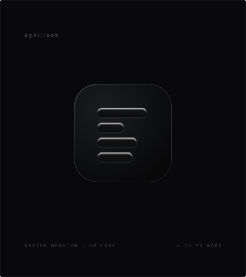
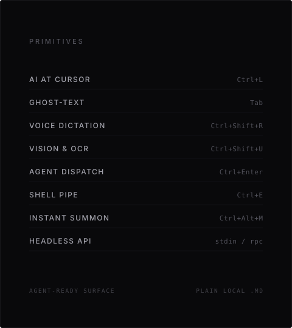
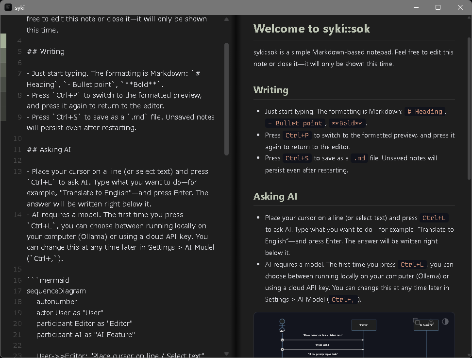

# syki::sok

An instant, featherweight Markdown scratchpad with AI right at your cursor.  

<p align="center">
  
  
</p>

---

### Primitives

| Action | Trigger | Outcome |
| :--- | :--- | :--- |
| **AI at Cursor** | `Ctrl+L` | Generates directly below selection. No chat hopping. |
| **Ghost-Text** | `Tab` | Local LLM predicts next sentence inline as you type. |
| **Voice Dictation** | `Ctrl+Shift+R` | Real-time AI dictation & in-place rescue prompt. |
| **Vision & OCR** | `Ctrl+Shift+U` | Smart OCR paste & instant zero-app mobile drop. |
| **Agent Dispatch** | `Ctrl+Enter` | Delegates `{{ @claude ... }}` tasks autonomously. |
| **Shell Pipe** | `Ctrl+E` | Streams selected lines into `jq`, `sort`, or CLI. |
| **Instant Summon** | `Ctrl+Alt+M` | Instant &lt; 15 ms wake via Go core (5–15 MB idle). |
| **Headless API** | `stdin / rpc` | `cat log \| syki` and complete JSON-RPC for agents. |

---

### Install

```powershell
# Windows (PowerShell)
Invoke-WebRequest https://github.com/youshinh/syki-sok/releases/latest/download/syki-windows-x64.zip -OutFile syki.zip; Expand-Archive syki.zip syki; syki\syki.exe
```

```bash
# macOS (Homebrew)
brew install --cask --no-quarantine youshinh/tap/syki
```

> 💡 **Tip (macOS)**: Passing `--no-quarantine` bypasses macOS Gatekeeper prompts on first launch and future updates, allowing seamless one-command upgrades via `brew upgrade --cask syki`.

---

### Cloud Sync & Knowledge Compiler (Zero-Inbox Wiki)

Point `scraps/` to **Google Drive for Desktop (Available offline)** to sync across multiple PCs and compile raw captures into a permanent Wiki without heavy vault apps:

1. **Capture (`scraps/YYYY-MM-DD.md`)**: Dump thoughts, terminal pipes, voice notes, and OCR into `syki::sok` with zero organizational friction.
2. **Absorb**: Run `powershell -File tools/absorb-scraps.ps1` (macOS: `./tools/absorb-scraps.sh`) or tell your agent (`claude`, `codex`, `agy`, `ollama`, or local OpenAI-compatible LLM) to absorb `scraps/`.
3. **Crystallize & Clear (`wiki/` & `archive/`)**: Following `AGENTS.md` and `INDEX.md`, the agent synthesizes insights into `wiki/YYYY-MM-DD-slug.md` with relative links, archives raw files into `archive/YYYY-MM/` (excluded from search), and clears today's scrap in-place (`<!-- syki:absorbed ... -->`) so open tabs across synced PCs hot-reload cleanly without resurrecting deleted files.

---

### Docs for AI

Feed **[`llms.txt`](llms.txt)** directly into your AI (Claude, ChatGPT, Gemini, Ollama) to ask anything.

*Human docs: [Web Manual](https://youshinh.github.io/syki-sok/manual.html) • [日本語 README](README_JA.md)*

---

<p align="center">
  
</p>

---

### License & Trademarks

The source code is distributed under the [MIT License](LICENSE). The MIT License does not cover the names and logos: **syki::sok™** and **ku::sok™** are unregistered trademarks of youshinh. If you distribute a fork or a modified build, give it another name and logo. See the [Trademark Policy](TRADEMARKS.md).
