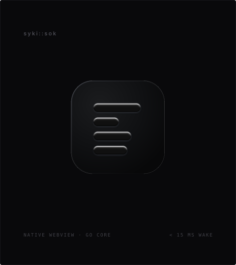
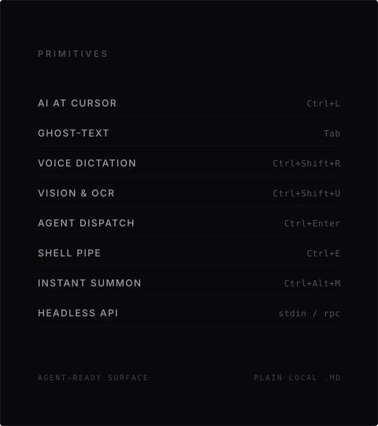
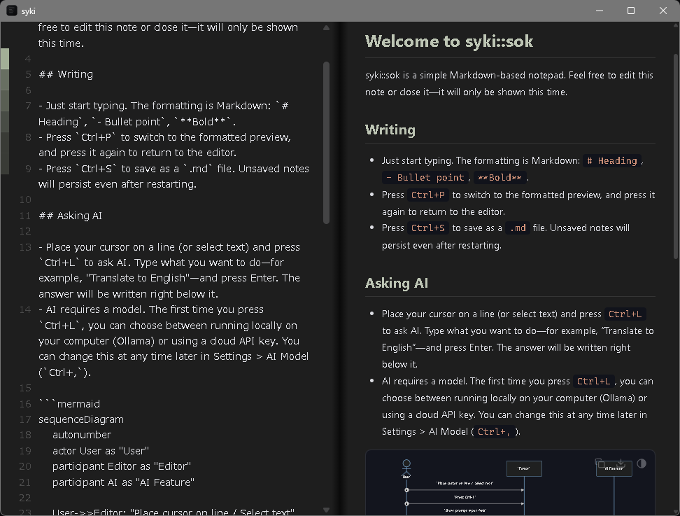

# syki::sok

<p align="center">
  <a href="https://github.com/youshinh/syki-sok/releases/latest"></a>
  <a href="https://github.com/youshinh/syki-sok/actions/workflows/ci.yml"></a>
  <a href="LICENSE"></a>
  
  
</p>

An instant, featherweight Markdown scratchpad with AI right at your cursor.  

<p align="center">
  
  
</p>

---

### Primitives

| Action | Trigger | Outcome |
| :--- | :--- | :--- |
| **AI at Cursor** | `Ctrl+L` | Generates directly below selection. No chat hopping. |
| **Ghost-Text** | `Tab` | Local LLM predicts next sentence inline as you type. |
| **Voice Dictation** | `Ctrl+Shift+R` | On-device speech.cpp (Haas-ja), streaming, and meeting diarization. |
| **Vision & OCR** | `Ctrl+Shift+U` | Smart OCR paste & instant zero-app mobile drop. |
| **Agent Dispatch** | `Ctrl+Enter` | Delegates `{{ @claude ... }}` tasks autonomously. |
| **Agent Terminal & Loop** | `Ctrl+Alt+T` | Embedded PTY pane (`cc`/`codex`/`agy`) with isolated-worktree Maker-Checker harness loops. |
| **Shell Pipe** | `Ctrl+E` | Streams selected lines into `jq`, `sort`, or CLI. |
| **Instant Summon** | `Ctrl+Alt+M` | Instant &lt; 15 ms wake via Go core (5–15 MB idle). |
| **Headless API / CLI** | `stdin / rpc` | `syki speech`, `cat log | syki` and complete JSON-RPC for agents. |

---

### Install

<details>
<summary>Windows (PowerShell)</summary>

```powershell
Invoke-WebRequest https://github.com/youshinh/syki-sok/releases/latest/download/syki-windows-x64.zip -OutFile syki.zip; Expand-Archive syki.zip syki; syki\syki.exe
```

</details>

<details>
<summary>macOS (Homebrew)</summary>

```bash
brew install --cask youshinh/tap/syki
```

> 💡 **Tip**: If macOS Gatekeeper blocks the first launch of an unsigned build, run `xattr -cr /Applications/syki.app` (or allow it via **System Settings → Privacy & Security → Open Anyway**).

</details>

---

### Cloud Sync & Knowledge Compiler

Sync `scraps/` via Google Drive or cloud folders across PCs:
- **Capture**: Dump thoughts, terminal pipes, voice, and OCR into `scraps/YYYY-MM-DD.md`.
- **Compile**: Run `tools/absorb-scraps.ps1` (or `.sh`) to let an AI compile scraps into `wiki/` and archive old notes.

---

### Docs for AI

Feed **[`llms.txt`](llms.txt)** directly into your AI (Claude, ChatGPT, Gemini, Ollama) to ask anything.

*Human docs: [Web Manual](https://youshinh.github.io/syki-sok/manual.html) • [日本語 README](README_JA.md)*

---

<p align="center">
  
</p>

---

### License & Trademarks

The source code is distributed under the [MIT License](LICENSE). The MIT License does not cover the names and logos: **syki::sok™** and **ku::sok™** are trademarks. If you distribute a fork or a modified build, give it another name and logo. See the [Trademark Policy](TRADEMARKS.md).
