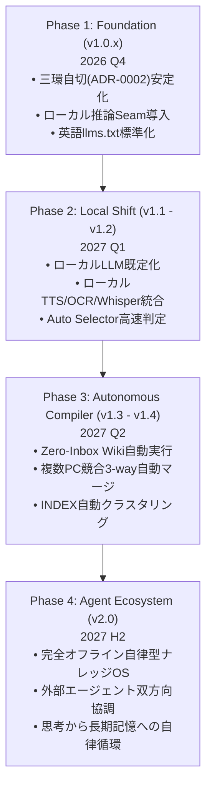

# syki::sok 今後の開発の方向性（Future Direction & Technical Roadmap）

| 項目 | 内容 |
|---|---|
| **対象** | `syki::sok` v1.0.0 以降（2026年〜2027年） |
| **位置づけ** | 将来のアーキテクチャ進化、ローカルLLMへの移行計画、思考プロセス、および機能拡張ロードマップ |
| **基本哲学** | **「思考の瞬間に開いている」ゼロ抵抗バッファ** ＆ **完全ローカル自律型ナレッジ基盤** |

---

## 1. エグゼクティブサマリー（Core Vision）

syki::sok は、重厚なノートアプリ（Notion / Obsidian）や巨大なIDE（VSCode）を開く前の**「思考の初速を1ミリ秒も殺さないゼロ抵抗バッファ」**として誕生した。

今後の開発における最大のマイルストーンは、**「今後1年の間に大半の推論処理を完全にローカルLLMへ移行する（Local-First Inference Evolution）」**ことにある。外部クラウドへの依存・課金・レイテンシ・プライバシーリスクを脱却し、ローカルGPU/NPU完結型のエージェント基盤へと深化させる。

---

## 2. 思考プロセスの軌跡（Why & Decision Rationale: なぜこの方向性になったのか）

現在のアーキテクチャと将来方針に至った背景には、既存ツールに対する深い違和感と、度重なる設計検証（ADR）に基づいた必然的な思考のステップが存在する。

### ① なぜ独自エディタなのか？（VSCode / Notion / Obsidian を使わなかった理由）
- **摩擦（Friction）の排除**:
  NotionやObsidianは保管庫として優れているが、起動に数秒かかり、メモリを数百MB〜数GB消費する。思考が立ち上がった瞬間（0.1秒）にメモを取るには重すぎ、準備をしている間にアイデアが霧散する。
- **結論**:
  Goネイティブコア＋OSネイティブWebView（Windows: WebView2, macOS: WKWebView）を採用し、**Electronを完全排除**。待機メモリ 5–15 MB、グローバルショートカットからの復帰 **15 ms 未満** を達成した。

### ② なぜチャットUIではなく「カーソル直結AI」なのか？
- **コンテキストスイッチの分断**:
  別ウィンドウやサイドバーのチャット欄に「プロンプトをコピペして質問し、返答を本文にコピペし直す」往復運動は、人間の執筆フロー体験を致命的に破壊する。
- **結論**:
  エディタのテキスト面そのものをAIのインターフェースと定義。選択行の直下にストリーミング回答を直接挿入する `Ctrl+L`、ローカルモデルによる予測次文補完 `Tab`、その場でのワンキー校正 `Alt+C` により、**視線を1ミリも動かさずにAIと共創できる環境**を設計した。

### ③ なぜ「三環自切（3-Ring Autotomy）アーキテクチャ」が必要だったのか？ (ADR-0002)
- **肥大化とクラッシュの恐怖**:
  音声入力、クリップボードOCR、スマホ中継（Cloudflare Bridge）、LAN転送（Mobile Drop）など、便利な周辺機能を拡張するにつれて、Goプロセスが肥大化し、万が一周辺機能のネット障害や外部ライブラリのパニックでエディタ本体が落ちたら「書きかけのメモが消える」という致命的リスクを抱えることになった。
- **トカゲの自切（Autotomy）からの着想**:
  - **Ring 0 (Stream Kernel)**: 不変のテキスト核。絶対に死んではいけない最深層。
  - **Ring 1 (Editor Canvas)**: 入力とレンダリングの層。IME Guardianで日本語入力を死守。
  - **Ring 2 (Receptor Organelles)**: 周辺器官（Dropzone, Bridge, Hot folder等）。
  周辺器官で何が起きても Ring 0/1 に波及せず、不要な器官は即座に自切（ShutdownOrganelles）できる構造を確立した。テレメトリやクラウド画像生成などの不要な肥大化コードを全廃したのもこの思想に基づく。

### ④ なぜ「完全ローカルLLM移行」へと舵を切るのか？ (Local-First Paradigm)
- **クラウドAPI依存の3大限界**:
  1. **コストの壁**: ゴースト予測補完や自動判定（Auto Selector）、日々のスクラップ自動編纂をクラウドAPIで常時稼働させると、使えば使うほど従量課金が跳ね上がり、ユーザーが気兼ねなく使い倒せなくなる。
  2. **レイテンシの壁**: クラウドAPIへの通信遅延（300ms〜数秒）は、打鍵の速度や思考の初速に追いつかない。思考の延長として機能するには 100ms 未満の応答が不可欠である。
  3. **究極のプライバシー**: スクラップには日々の感情、未整理のアイデア、仕事の機密、個人情報がそのまま書き殴られる。これを外部クラウドへ送信することへの潜在的な抵抗感が、メモの自由度を奪う。
- **ハードウェアとSLMの進化**:
  RTX 4070（12GB VRAM）をはじめとするローカルGPU/NPUの普及と、小型言語モデル（Qwen 2.5/3.8, Gemma 2/3, Phi-4 等）の飛躍的進化により、ローカル推論の品質が実用水準に達した。
- **結論**:
  「クラウドAPIを主とし、ローカルを補助とする」従来モデルを逆転させ、**「ローカル完結（Local-First）を前提とし、クラウドは必要な時だけのオプショナルな接合部（Seam）とする」**方針を確定した。

### ⑤ なぜ「色即是空（Zero-Inbox Wiki）」という編纂思想なのか？ (ADR-0001)
- **メモの墓場化問題**:
  メモは書き散らすほど溜まるが、手動でフォルダ分けやタグ付けを行おうとすると管理の重圧で破綻し、最終的に「検索不能なメモのゴミ箱」になる。
- **結論**:
  人間は「その日のノートに書き捨てる（色）」だけでよい。深夜にエージェントが自動で有用な知識を結晶化して `wiki/` へ移し、元ノートはインプレースで浄化（空）して翌朝まっさらな状態にする。この代謝サイクルを自動化することで、人間の脳のワーキングメモリを常に解放する。

### ⑥ なぜ「英語 llms.txt」と「極小・ミニマリズム表記」なのか？
- **AIネイティブ基盤としての役割**:
  syki::sok は人間だけでなく、外部の自律エージェント（Cursor, Claude Code, Codex, Antigravity）が読み取り、操作するプラットフォームである。
- **結論**:
  グローバルなAIエコシステムの共通語である英語で `llms.txt` を定義し、無駄な装飾や冗長な説明を排して極小トークン（token-lean）に凝縮することで、AIエージェントのコンテキスト浪費を防ぎ、仕様準拠精度を極限まで高めている。

---

## 3. 重点開発領域（Key Strategic Pillars）

### Pillar 1: ローカル推論スタックの完全整備 (Local-First AI Stack)
1. **OpenAI互換ローカル推論 Seam の拡充**:
   - `Strata` / `Ollama` / `llama.cpp` / `vLLM` などのローカルエンドポイント（`http://127.0.0.1:8080/v1` 等）への対応を第一級市民として強化。
   - `IsLocalEndpoint` 判定に基づき、クラウドAPIキー未設定でもローカルエンドポイントがあれば即座に全AI機能（`Ctrl+L`, `Alt+C`, `Tab`）をシームレス稼働。
2. **オンデバイス・マルチモーダルのネイティブ統合**:
   - **音声認識 (STT)**: Windows x64 版 on-device Whisper の安定性向上、および macOS（CoreML/Whisper.cpp）への展開。
   - **音声合成 (TTS)**: `VoiceStyleOpenAI` による軽量ローカルTTS（Kokoro TTS等）の統合。
   - **ローカルOCR & Vision**: クリップボード画像・ドロップ画像・画面キャプチャをローカルVLM（Moondream, MiniCPM-V, Qwen-VL）で完全オフライン解析。
3. **ローカル・セマンティック検索 & ベクトル索引**:
   - `EmbeddingGemma`（MRL 256次元）による数千〜数万件のメモの超高速・低メモリベクトル検索。
   - 外部クラウドAPI（Gemini Embedding 等）を不要とし、ローカルCPU/GPUで毎秒数千ドキュメントのコサイン類似度照合。

### Pillar 2: エージェント連携と超高速判定基盤 (Agentic Substrate & Decision Engine)
1. **ミリ秒単位の型付き決定モデル (Decision Models)**:
   - 長大なプロンプトや文章生成をバイパスし、次にとるべきアクション（Choice / Predicate / Score）をミリ秒単位で型安全に判定するエンジン（TypeSafe Jev、OpenAI Decisions API `gpt-6-luna`、超小型ローカル分類モデル）の統合。
   - `Ctrl+Enter`（Auto Selector）および `Ctrl+J`（Next Actions）の文脈判定精度の極大化。
2. **外部自律コーディングエージェントとの Seam 強化**:
   - Claude Code, Codex, Antigravity (AGY), Google Jules などの自律エージェントとのプロセス間通信（IPC）およびタスク結果ブロック（`<!-- syki:res -->`）の双方向ハンドシェイク。
   - **自己学習「教訓（Lessons）」機能のローカルループ化**: 失敗ログからの反省・ルール抽出をローカルLLMで完結させ、プロンプトへの前置ルールを自律最適化。

### Pillar 3: クラウド同期・ナレッジ編纂の自動化 (Cloud Sync & Knowledge Compiler)
1. **常駐型自律コンパイラ (Zero-Inbox Wiki Daemon)**:
   - `tools/absorb-scraps.ps1` / `absorb-scraps.sh` を OS ネイティブ（Windows タスクスケジューラ / macOS launchd）またはローカルエージェントの cron と連動させ、毎晩自動で実行。
   - `INDEX.md`（150行上限の自己圧縮インデックス）のトピッククラスタリング機能。
2. **マルチPC・オフライン同期の堅牢性向上**:
   - Google Drive / Dropbox / iCloud 等のオフライン同期フォルダにおける「In-Place Clear（インプレース浄化）」の完全徹底。
   - 同時編集による競合ファイル（`YYYY-MM-DD (1).md` 等）の本文三方マージ（Three-Way Merge）によるコンフリクト解消の全自動化。

### Pillar 4: エディタ体験・パフォーマンスの極致 (Featherweight Canvas)
1. **Electron不使用（Go + OS Native WebView）の徹底維持**:
   - 待機メモリ 5–15 MB、ホットキー復帰 < 15 ms を死守。
   - 10万〜100万文字規模の巨大ノートにおけるキャレット追従性・レンダリングの最適化。
2. **IME Guardian & キーボード操作性**:
   - 日本語入力（IMEオン）状態での全角Markdown記号自動正規化、JIS配列キーの誤打鍵防御の洗練。
   - キーボードのみですべてが完結するコマンドバー（`Ctrl+E`）とパレット（`Ctrl+Shift+P`）の拡張。

---

## 4. フェーズ別ロードマップ（Milestones 2026 - 2027）

| フェーズ | 時期目安 | 主要テーマ | 主な成果物・マイルストーン |
|---|---|---|---|
| **Phase 1: Foundation (v1.0.x)** | 2026 Q4 | 安定化 & ローカル接合部の確立 | • ADR-0002（三環自切）完全適合 • `IsLocalEndpoint` / ローカル推論Seamの導入 • `llms.txt` 英文標準化 & 商標統一 |
| **Phase 2: Local Shift (v1.1 - v1.2)** | 2027 Q1 | ローカル推論の標準化 | • ローカルLLM（Ollama/Strata）を既定モデルに昇格 • ローカルKokoro/TTSおよびローカルOCRの統合 • `Ctrl+Enter` 自動判定のローカル小型モデル化 |
| **Phase 3: Autonomous Compiler (v1.3 - v1.4)** | 2027 Q2 | Zero-Inbox Wikiの自動化 | • 常駐型スクラップ自動編纂デーモンの内蔵 • 複数PC競合の3-wayマージ自動解決 • `INDEX.md` のトピック別自動クラスタリング |
| **Phase 4: Agent Ecosystem (v2.0)** | 2027 H2 | 完全自律型ナレッジOS | • ローカルモデルによる完全オフライン自律運用 • 外部エージェント（Claude/Codex/AGY）との双方向協調 • 思考バッファから長期記憶への自律循環 |

---

## 5. 非目標・やらないこと（Non-Goals）

1. **重量級オールインワン保管庫化（No Bloat）**:
   - Obsidian プラグインエコシステムのような肥大化や、Notion のような重厚なブロックDB化は目指さない。あくまで「思考の瞬間に開く超軽量バッファ」にとどまる。
2. **クラウド囲い込み・独自サーバ（Zero Lock-in）**:
   - 独自の同期クラウドやプロプライエタリなデータベースは一切持たない。すべて POSIX 互換プレーンテキスト Markdown ファイルとしてユーザーの手元に残す。
3. **Electron の採用（Electron-Free）**:
   - 開発の容易さのために Electron や重厚フレームワークに回帰することは絶対にしない。Go + Native WebView のミニマリズムを死守する。
