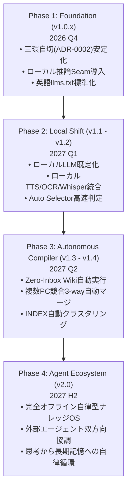

# syki::sok 今後の開発の方向性（Future Direction & Technical Roadmap）

| 項目 | 内容 |
|---|---|
| **対象** | `syki::sok` v1.0.0 以降（2026年〜2027年） |
| **位置づけ** | 将来のアーキテクチャ進化、ローカルLLMへの移行計画、および機能拡張ロードマップ |
| **基本哲学** | **「思考の瞬間に開いている」ゼロ抵抗バッファ** ＆ **完全ローカル自律型ナレッジ基盤** |

---

## 1. エグゼクティブサマリー & 最重要方針（Core Philosophy）

### ① 1年以内の「完全ローカルLLM移行」（Local-First Inference Evolution）
- **大方針**: 今後1年の間に、大半の推論処理（テキスト対話、ワンキー校正、予測補完、音声認識、画像OCR、ナレッジ編纂）を外部クラウド依存から**ローカルGPU/NPU完結（Local-First）**へ完全移行する。
- **狙いと利点**:
  - **コストゼロ**: トークン消費・課金を気にせず、常時バックグラウンドでエージェントを稼働。
  - **ゼロ遅延**: 外部ネットワーク往復を排除し、思考の速度（<100ms）で補完・校正・判定を提供。
  - **100% プライバシー保護**: 機密情報や日々の思考の断片を一切外部へ送信しない完全閉塞環境の実現。
  - **完全オフライン動作**: ネット環境のない移動中やオフライン環境でも同一のAI支援を保証。

### ② 三環自切アーキテクチャ（3-Ring Autotomy）の深化
ADR-0002 で確立した「不変の核と、切り離し可能な器官」の境界をさらに厳格化する：
- **Ring 0 (Stream Kernel)**: 不変のテキスト核。メモリ 5–15 MB、前面復帰 <15 ms。依存関係ゼロでクラッシュ不能。
- **Ring 1 (Editor Canvas)**: Markdown、IME Guardian、JIS配列保護、カーソルオーラ。入力の純粋性を担保。
- **Ring 2 (Receptor Organelles)**: 周辺器官（Dropzone, Cloudflare Bridge, Inbox Hot Folder, 音声認識, OCR）。自律分離・オンデマンド起動・安全な自切（Autotomy）により、周辺器官の障害がエディタを道連れにしない。

### ③「色即是空」Knowledge Compiler の完全自動化（Zero-Inbox Wiki）
ADR-0001 に基づく「日々の粗いメモ（`scraps/`）を構造化された永続知識（`wiki/`）へ結晶化する」運用を、ユーザーの能動的な手作業から、ローカルエージェントによる**夜間自律コンパイル（Zero-Inbox Wiki）**へと進化させる。

---

## 2. 重点開発領域（Key Strategic Pillars）

### Pillar 1: ローカル推論スタックの完全整備 (Local-First AI Stack)
1. **OpenAI互換ローカル推論 Seam の拡充**:
   - `Strata` / `Ollama` / `llama.cpp` / `vLLM` などのローカルエンドポイント（`http://127.0.0.1:8080/v1` 等）への対応を第一級市民として強化。
   - `IsLocalEndpoint` 判定に基づき、クラウドAPIキー未設定でもローカルエンドポイントがあれば即座に全AI機能（`Ctrl+L`, `Alt+C`, `Tab`）をシームレス稼働。
2. **オンデバイス・マルチモーダルのネイティブ統合**:
   - **音声認識 (STT)**: Windows x64 版 on-device Whisper の安定性向上、および macOS（CoreML/Whisper.cpp）への展開。
   - **音声合成 (TTS)**: `VoiceStyleOpenAI` による軽量ローカルTTS（Kokoro TTS等）の統合。
   - **ローカルOCR & Vision**: クリップボード画像・ドロップ画像・画面キャプチャをローカルVLM（Moondream, MiniCPM-V, Qwen-VL）で完全オフライン解析。
3. **ローカル・セマンティック検索 & ベクトル索引**:
   - `EmbeddingGemma`（MRL 256次元）による数千〜数万件のメモの超高速・低メモリベクトル検索。
   - 外部クラウドAPI（Gemini Embedding 等）を不要とし、ローカルCPU/GPUで毎秒数千ドキュメントのコサイン類似度照合。

### Pillar 2: エージェント連携と超高速判定基盤 (Agentic Substrate & Decision Engine)
1. **ミリ秒単位の型付き決定モデル (Decision Models)**:
   - 長大なプロンプトや文章生成をバイパスし、次にとるべきアクション（Choice / Predicate / Score）をミリ秒単位で型安全に判定するエンジン（TypeSafe Jev、OpenAI Decisions API `gpt-6-luna`、超小型ローカル分類モデル）の統合。
   - `Ctrl+Enter`（Auto Selector）および `Ctrl+J`（Next Actions）の文脈判定精度の極大化。
2. **外部自律コーディングエージェントとの Seam 強化**:
   - Claude Code, Codex, Antigravity (AGY), Google Jules などの自律エージェントとのプロセス間通信（IPC）およびタスク結果ブロック（`<!-- syki:res -->`）の双方向ハンドシェイク。
   - **自己学習「教訓（Lessons）」機能のローカルループ化**: 失敗ログからの反省・ルール抽出をローカルLLMで完結させ、プロンプトへの前置ルールを自律最適化。

### Pillar 3: クラウド同期・ナレッジ編纂の自動化 (Cloud Sync & Knowledge Compiler)
1. **常駐型自律コンパイラ (Zero-Inbox Wiki Daemon)**:
   - `tools/absorb-scraps.ps1` / `absorb-scraps.sh` を OS ネイティブ（Windows タスクスケジューラ / macOS launchd）またはローカルエージェントの cron と連動させ、毎晩自動で実行。
   - `INDEX.md`（150行上限の自己圧縮インデックス）のトピッククラスタリング機能。
2. **マルチPC・オフライン同期の堅牢性向上**:
   - Google Drive / Dropbox / iCloud 等のオフライン同期フォルダにおける「In-Place Clear（インプレース浄化）」の完全徹底。
   - 同時編集による競合ファイル（`YYYY-MM-DD (1).md` 等）の本文三方マージ（Three-Way Merge）によるコンフリクト解消の全自動化。

### Pillar 4: エディタ体験・パフォーマンスの極致 (Featherweight Canvas)
1. **Electron不使用（Go + OS Native WebView）の徹底維持**:
   - 待機メモリ 5–15 MB、ホットキー復帰 < 15 ms を死守。
   - 10万〜100万文字規模の巨大ノートにおけるキャレット追従性・レンダリングの最適化。
2. **IME Guardian & キーボード操作性**:
   - 日本語入力（IMEオン）状態での全角Markdown記号自動正規化、JIS配列キーの誤打鍵防御の洗練。
   - キーボードのみですべてが完結するコマンドバー（`Ctrl+E`）とパレット（`Ctrl+Shift+P`）の拡張。

---

## 3. フェーズ別ロードマップ（Milestones 2026 - 2027）

| フェーズ | 時期目安 | 主要テーマ | 主な成果物・マイルストーン |
|---|---|---|---|
| **Phase 1: Foundation (v1.0.x)** | 2026 Q4 | 安定化 & ローカル接合部の確立 | • ADR-0002（三環自切）完全適合 • `IsLocalEndpoint` / ローカル推論Seamの導入 • `llms.txt` 英文標準化 & 商標統一 |
| **Phase 2: Local Shift (v1.1 - v1.2)** | 2027 Q1 | ローカル推論の標準化 | • ローカルLLM（Ollama/Strata）を既定モデルに昇格 • ローカルKokoro/TTSおよびローカルOCRの統合 • `Ctrl+Enter` 自動判定のローカル小型モデル化 |
| **Phase 3: Autonomous Compiler (v1.3 - v1.4)** | 2027 Q2 | Zero-Inbox Wikiの自動化 | • 常駐型スクラップ自動編纂デーモンの内蔵 • 複数PC競合の3-wayマージ自動解決 • `INDEX.md` のトピック別自動クラスタリング |
| **Phase 4: Agent Ecosystem (v2.0)** | 2027 H2 | 完全自律型ナレッジOS | • ローカルモデルによる完全オフライン自律運用 • 外部エージェント（Claude/Codex/AGY）との双方向協調 • 思考バッファから長期記憶への自律循環 |

---

## 4. 非目標・やらないこと（Non-Goals）

1. **重量級オールインワン保管庫化（No Bloat）**:
   - Obsidian プラグインエコシステムのような肥大化や、Notion のような重厚なブロックDB化は目指さない。あくまで「思考の瞬間に開く超軽量バッファ」にとどまる。
2. **クラウド囲い込み・独自サーバ（Zero Lock-in）**:
   - 独自の同期クラウドやプロプライエタリなデータベースは一切持たない。すべて POSIX 互換プレーンテキスト Markdown ファイルとしてユーザーの手元に残す。
3. **Electron の採用（Electron-Free）**:
   - 開発の容易さのために Electron や重厚フレームワークに回帰することは絶対にしない。Go + Native WebView のミニマリズムを死守する。
